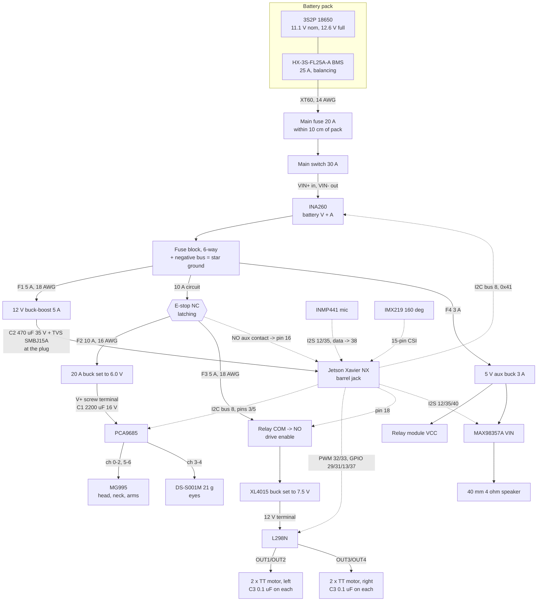

# Wiring: power, protection and signals

Everything that connects to the Jetson Xavier NX, from the battery to the last
servo. The full parts list and shopping links live in the electronics plan
doc; this file is the bench reference.

Pin numbers are Jetson 40-pin header BOARD numbers (the physical pin, 1-40),
the same numbering as `config/robot.yaml`.

## Overview



Solid arrows carry power, dashed arrows carry signals. The e-stop sits only on
the servo and drive branches, so pressing it freezes Wall-E but leaves the
Jetson running to log the event.

## Power branches

| Branch | From | Converter / setting | Fuse | Wire | Feeds |
|---|---|---|---|---|---|
| Main | Pack (XT60) | none | 20 A, within 10 cm of the pack | 14 AWG | switch, INA260, fuse block |
| Jetson | Fuse block | 12 V automatic buck-boost, 5 A | F1 5 A | 18 AWG | Xavier NX barrel jack |
| Servos | Fuse block via e-stop | 20 A buck, set to **6.0 V** | F2 10 A | 16 AWG | PCA9685 V+ screw terminal |
| Drive | Fuse block via e-stop and relay | XL4015, set to **7.5 V** | F3 5 A | 18 AWG | L298N "12V" terminal |
| Aux | Fuse block | 5 V buck, 3 A | F4 3 A | 20 AWG | relay module VCC, MAX98357A VIN, status LED |

Set every converter's output with a meter **before** connecting its load.
Run all negative wires back to the fuse block's negative bus (star ground);
that bus is the only place battery negative, converter grounds and Jetson
ground meet.

The INA260 is rated 15 A continuous. The 20 A main fuse protects the wiring;
normal peaks stay around 10 to 12 A, so the INA260 is not overloaded.

## Capacitors and protection parts

| Ref | Part | Where it goes | Why |
|---|---|---|---|
| C1 | 2200 uF 16 V low-ESR electrolytic | Across the PCA9685 V+ screw terminal (the board has a footprint for it). Stripe (negative) to GND | Covers the current burst when several servos start at once, so the rail does not dip |
| C2 | 470 uF 35 V electrolytic | Across the 12 V buck-boost output, right at the Jetson's barrel plug | Smooths spikes and dips on the Jetson supply |
| D1 | SMBJ15A TVS diode | Same place as C2, cathode (band) to +12 V | Clamps voltage spikes before they reach the Jetson |
| C3 | 0.1 uF ceramic ("104"), x4 | Soldered directly across the two terminals of each TT motor | Kills brush noise that otherwise upsets I2C and USB |

Electrolytic capacitors and the TVS diode are polarised: reversed, they fail,
sometimes loudly. Check the stripe or band twice.

## E-stop and drive relay

```
fuse block 10 A circuit ──> E-stop NC ──┬──> F2 ──> servo 6 V buck
                                        └──> F3 ──> relay COM, relay NO ──> XL4015 ──> L298N
E-stop NO aux contact: one side to Jetson pin 16, other side to GND (pin 14)
```

- **E-stop:** 22 mm latching mushroom with an NC contact block carrying the
  servo and drive current, plus an NO contact block (ZB2-BE101C) that tells
  the Jetson it was pressed. Pin 16 uses the internal pull-up, so "pressed"
  reads low. Twist to release.
- **Relay (Keyes SR1y, Songle SRD-05VDC-SL-C, contacts 10 A at 30 V DC):**
  wire the motor supply through **COM and NO**, not NC. With no power or no
  signal the relay is open and the motors are dead, which is the safe default.
  Module VCC to aux 5 V, GND to ground, signal (S) to Jetson pin 18. Most of
  these modules switch fine from a 3.3 V signal; check that it clicks before
  relying on it.

## Jetson 40-pin header

| Pin | Name | Goes to | Notes |
|---|---|---|---|
| 1 | 3.3 V | PCA9685 VCC, INA260 VCC, INMP441 VDD | logic only, a few mA each |
| 3 | I2C SDA (bus 8) | PCA9685 SDA, INA260 SDA | |
| 5 | I2C SCL (bus 8) | PCA9685 SCL, INA260 SCL | |
| 6 | GND | PCA9685 GND, INA260 GND | |
| 7 | GPIO out | status LED + 330 ohm resistor to GND | |
| 12 | I2S BCLK | MAX98357A BCLK, INMP441 SCK | |
| 13 | GPIO out | L298N IN3 | moved off pin 35 for I2S |
| 14 | GND | e-stop NO contact | |
| 16 | GPIO in | e-stop NO contact | pull-up, pressed = low |
| 18 | GPIO out | relay module S | high = drive power on |
| 29 | GPIO out | L298N IN1 | |
| 31 | GPIO out | L298N IN2 | |
| 32 | PWM | L298N ENA | **remove the ENA jumper cap** |
| 33 | PWM | L298N ENB | **remove the ENB jumper cap** |
| 35 | I2S LRCLK | MAX98357A LRC, INMP441 WS | |
| 37 | GPIO out | L298N IN4 | |
| 38 | I2S data in | INMP441 SD | |
| 39 | GND | L298N GND | ties logic grounds together |
| 40 | I2S data out | MAX98357A DIN | |
| CSI 0 | camera | IMX219 160 deg, 15-pin ribbon | contacts face the board's contacts |

PWM pins 32/33 must be enabled with `jetson-io` (see
[jetson-setup.md](jetson-setup.md)). The I2S pins need a device-tree overlay
before Linux sees the amp and mic; that is a Phase 4 task.

## Boards

**L298N.** Fed from the 7.5 V motor buck, so its onboard 5 V regulator jumper
stays fitted. Do not connect its "+5V" terminal to anything. Two TT motors in
parallel per side: left pair on OUT1/OUT2, right pair on OUT3/OUT4. If a side
runs backwards, swap its two motor wires or set `inverted: true` in the
config. Until the 7.5 V buck is in, `drive.max_speed: 0.5` keeps the motors
near their 6 V rating on the raw pack.

**PCA9685.** VCC (logic) from Jetson pin 1; V+ (servo power) only from the
6 V buck through the screw terminal, never from the Jetson. Address 0x7F in
the old project (all address pads bridged); confirm with
`sudo i2cdetect -y -r 8`.

**INA260.** High-side, in series with the main positive lead after the switch:
current in at VIN+, out at VIN-. Bridge its A0 pad to VCC to move it from
0x40 to **0x41**, so it can never clash with a PCA9685 left at the factory
address.

**MAX98357A + speaker.** VIN from aux 5 V (louder than 3.3 V, and the Jetson's
3.3 V pin is not meant for a 3 W amp), GND to ground, BCLK/LRC/DIN as in the
table, speaker on the + and - terminals. Leave GAIN and SD unconnected for
the defaults.

**INMP441 mic.** VDD 3.3 V from pin 1, GND, SCK/WS/SD as in the table, and
**L/R to GND** (left channel).

**IMX219 camera.** 15-pin CSI ribbon into CSI 0 with power off. The OV5647
fisheye modules do not work with the stock Jetson drivers.

## Rules that protect the Jetson

1. **Servos and motors never draw from the Jetson.** Their power comes from
   their own converters. The Jetson's 3.3 V pin powers logic only.
2. **One common ground.** Every board ground meets at the fuse block's
   negative bus, or the control signals have no reference.
3. **Jetson pins are 3.3 V and not 5 V tolerant.** We only drive outputs into
   the L298N and relay (both accept 3.3 V as high) and read the e-stop contact
   against ground. Never wire a 5 V signal into a Jetson pin.
4. **First power-up through the XT60 smoke stopper.** It blows its small fuse
   instead of a wire if something is shorted. Remove it once every voltage
   checks out; it cannot carry the running current.

## Servo channel map

Carried over from the old Arduino firmware; see `config/robot.yaml`.

| Ch | Joint (name in config) | Servo |
|---|---|---|
| 0 | head_pan | MG995 |
| 1 | neck_upper | MG995 |
| 2 | neck_lower | MG995 |
| 3 | eye_right | DS-S001M 21 g |
| 4 | eye_left | DS-S001M 21 g |
| 5 | arm_right | MG995 |
| 6 | arm_left | MG995 |
| 7-15 | free | |
