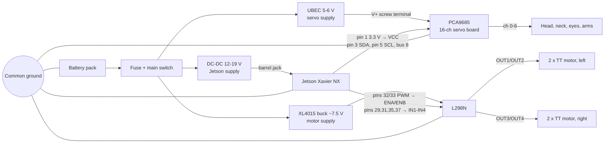

# Wiring: Jetson ↔ motor driver ↔ servo board

Signal wiring for the first features. Battery, fuse, switch and DC-DC sizing
are covered by the electronics wishlist; the power boxes below are placeholders
for whatever that settles on.

## Pin table (Jetson 40-pin header, BOARD numbering)

| Jetson pin | Name | Goes to | Notes |
|---|---|---|---|
| 1 | 3.3 V | PCA9685 VCC | logic power only, a few mA |
| 3 | I2C SDA | PCA9685 SDA | I2C bus 8 on the Xavier NX |
| 5 | I2C SCL | PCA9685 SCL | |
| 6 | GND | PCA9685 GND | |
| 32 | PWM | L298N ENA | **remove the ENA jumper cap** |
| 29 | GPIO | L298N IN1 | |
| 31 | GPIO | L298N IN2 | |
| 33 | PWM | L298N ENB | **remove the ENB jumper cap** |
| 35 | GPIO | L298N IN3 | |
| 37 | GPIO | L298N IN4 | |
| 39 | GND | L298N GND | ties logic grounds together |

**Four drive motors, two channels:** wire the two left motors in parallel to
OUT1/OUT2 and the two right motors to OUT3/OUT4. They are 3-6 V TT gear
motors, so the L298N is fed from a buck set to about 7.5 V (the L298N drops
about 2 V, leaving ~6 V at the motors). Two TT motors per channel stay well
inside the L298N's 2 A rating. Until that buck is in, `drive.max_speed: 0.5`
in `config/robot.yaml` keeps the average motor voltage near 6 V on the raw
pack.

## Rules that protect the Jetson

1. **Servos never draw from the Jetson.** Servo power goes into the PCA9685's
   V+ screw terminal from its own supply. The Jetson only powers the chip's
   logic (pin 1 → VCC).
2. **Do not connect the L298N's "+5V" terminal to the Jetson.** Leave its
   5 V regulator jumper as is and leave that terminal unconnected (or use it
   only for the L298N itself).
3. **One common ground.** Jetson GND, PCA9685 GND, L298N GND and battery
   negative must all connect, or the control signals have no reference.
4. **Jetson pins are 3.3 V and not 5 V tolerant.** We only drive outputs into
   the L298N (its inputs accept 3.3 V as high), so no level shifter is needed.
   Never wire a 5 V signal back into a Jetson pin.

## Servo channel map

Carried over from the old Arduino firmware; see `config/robot.yaml`.

| Ch | Joint (name in config) |
|---|---|
| 0 | head_pan |
| 1 | neck_upper |
| 2 | neck_lower |
| 3 | eye_right |
| 4 | eye_left |
| 5 | arm_right |
| 6 | arm_left |
| 7-15 | free |
